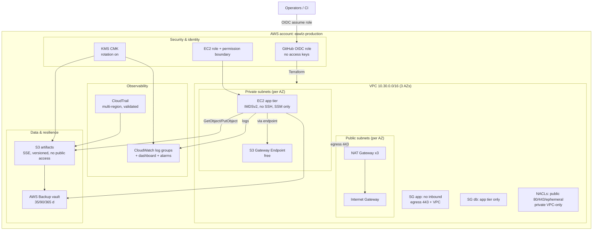
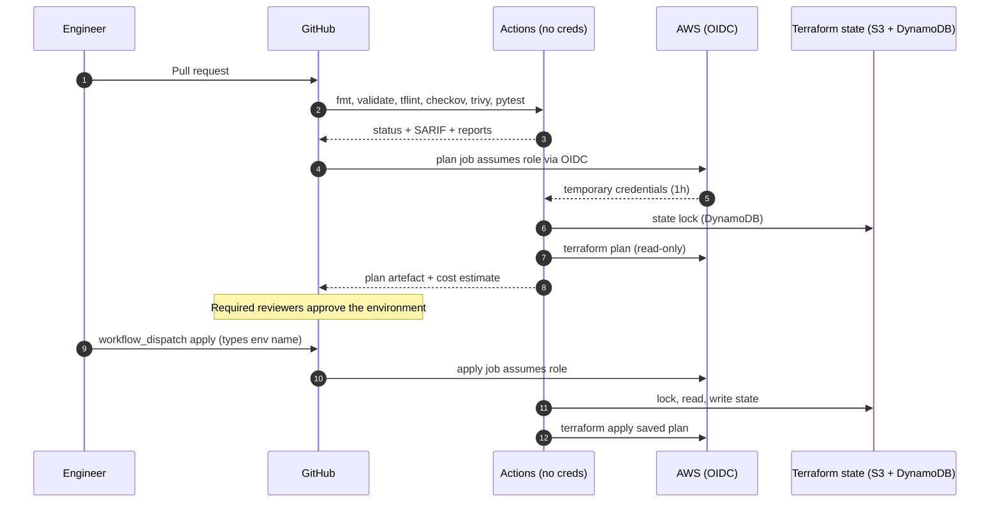

# Architecture

## 1. Design goals

| Goal | How the design meets it |
|---|---|
| Environment isolation | Separate AWS accounts (recommended), separate state keys, non-overlapping CIDRs, per-environment KMS/IAM |
| Blast-radius control | One VPC per environment, no cross-environment peering, private workloads only |
| Predictable cost | Every billable resource behind a flag; `zero_cost_mode` interlock |
| Auditability | CloudTrail (multi-region, file validation), CloudWatch log groups, tag-based ownership |
| Recoverability | AWS Backup tiers + versioning + full IaC recreation path |
| Reviewability | Thin environment roots, reusable modules, one tfvars diff per environment |

## 2. Logical architecture

A static, reviewable copy of the same design is in
[diagrams/aws-landing-zone-architecture.mmd](../diagrams/aws-landing-zone-architecture.mmd)
with the rendered image at
[diagrams/aws-landing-zone-architecture.png](../diagrams/aws-landing-zone-architecture.png).

## 3. Request and change flows

## 4. Module boundaries

| Module | Owns | Does not own |
|---|---|---|
| `networking` | VPC, subnets, routing, NAT (optional), NACLs, SGs, S3 endpoint, flow logs (optional) | Instances, IAM, buckets |
| `security` | KMS CMK, key policy, alias | What gets encrypted with it |
| `iam` | Workload role + boundary, CI OIDC role + policy | Attaching roles to anything |
| `ec2` | Instances, volumes, user data, IMDS settings | Networking, IAM definitions |
| `s3` | Bucket, encryption, versioning, PAB, lifecycle, TLS policy | Who may read it (IAM module) |
| `monitoring` | Log groups, dashboard, alarms (optional), CloudTrail (optional) | Application metrics |
| `backup` | Vault, plan, rules, tag selection | Restore execution |

Dependencies flow one way: `security → s3 → iam → ec2`, with `networking`
independent and `monitoring`/`backup` consuming outputs. No cycles, which is why
`terraform graph` stays readable and plans stay fast.

## 5. Key decisions and trade-offs

| Decision | Alternative | Why this one |
|---|---|---|
| Separate directories per environment | Terraform workspaces | Workspaces share one backend and one variable set; a typo can target production. Directories give distinct state, distinct tfvars and distinct approval paths. Cost: three plan runs in CI. |
| No data sources for AZs/account | `aws_availability_zones`, `aws_caller_identity` | Data sources force an API call during plan, which breaks offline validation. AZs and account ID are inputs. |
| NAT optional, off by default | Always-on NAT | A NAT Gateway is ~\$32/month before data processing; dev does not need it. |
| No bastion, SSM only | Bastion host + SSH | Removes an internet-facing host and long-lived SSH keys entirely. |
| Tag-based backup selection | Explicit resource lists | New resources are protected by tagging; trade-off is that an untagged resource is silently unprotected, so `tagging_validator.py` enforces the tags in CI. |
| CloudTrail in the monitoring module | Dedicated audit account/trail | Simpler for a single-account portfolio; a real enterprise would centralise trails in a log-archive account. |

## 6. Failure domains

| Failure | Impact | Mitigation |
|---|---|---|
| One AZ down | 1/3 capacity lost (prod) | 3 AZs, one instance each, per-AZ NAT |
| NAT Gateway down (single NAT envs) | Egress lost | Production uses per-AZ NAT |
| State bucket deleted | Terraform cannot plan | Versioning, PAB, `prevent_destroy` guidance in bootstrap README |
| State lock stuck | Plan/apply blocked | DynamoDB PITR + documented `force-unlock` procedure |
| KMS key deleted | Encrypted data unreadable | 30-day deletion window, MFA-gated deny in key policy |
| CI compromised | Scoped blast radius | OIDC trust pinned to repo/environment, 1h sessions, explicit deny guardrails |

## 7. What this architecture deliberately does not include

* **No live AWS deployment** — no credentials were used; see
  [TESTING.md](TESTING.md) for exactly what was run.
* **No EKS/ECS, ALB or RDS** — the platform is a networking/IAM/storage/audit
  foundation; workloads attach later.
* **No AWS Organizations / Control Tower** — multi-account governance is
  described, not implemented.
* **No cross-region replication** — backup-based DR is implemented; replication is
  documented as the next step when RPO tightens below 24h.
