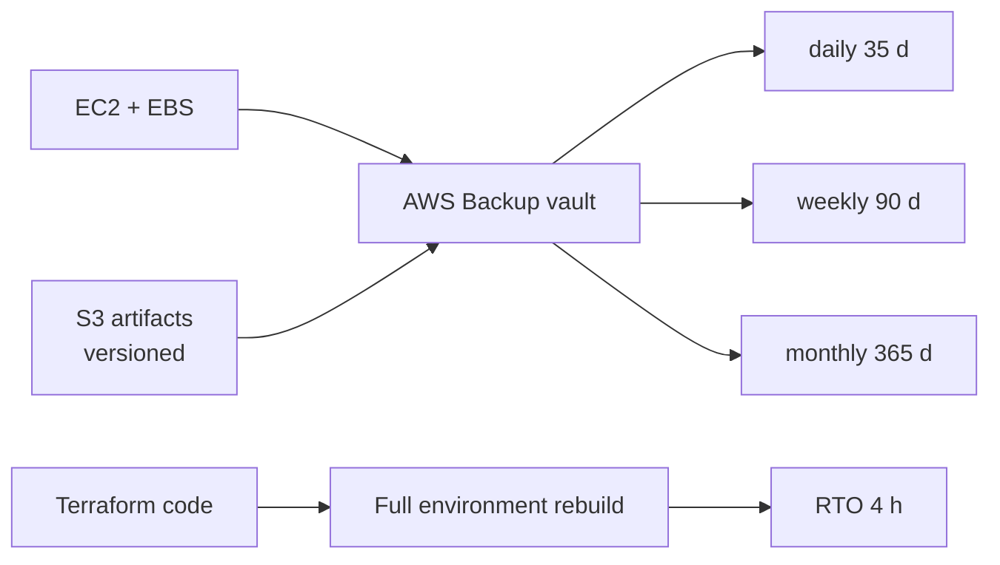

# Backup and disaster recovery

## 1. Objectives

| Environment | RPO | RTO | Basis |
|---|---|---|---|
| dev | 24 h (or none) | best effort | reproducible from code |
| staging | 24 h | 4 h | daily backups plus IaC |
| production | 24 h | 4 h | AWS Backup tiers plus IaC plus versioned S3 |

RPO is the maximum acceptable data loss; RTO the maximum acceptable downtime.
Both are **targets**, not measured results: no restore test has been executed.

## 2. Strategy



Three layers, because they fail differently:

1. **AWS Backup** for point-in-time recovery of volumes and buckets.
2. **S3 versioning** for object-level mistakes (overwrite, delete).
3. **Infrastructure as code** for total loss: the environment can be rebuilt from
   git plus state, with no manual reconstruction.

## 3. Backup configuration

| Rule | Schedule (UTC) | Retention | Purpose |
|---|---|---|---|
| daily | 03:00 every day | 35 d | operational recovery |
| weekly | Sunday 03:30 | 90 d | bad deploy or regression |
| monthly | 1st 03:00 | 365 d | compliance |

Selection is tag-based (`Backup = true`), so a new resource is protected by adding
a tag. The trade-off: an untagged resource is silently unprotected, which is why
`tagging_validator.py` enforces the tag in CI.

Vaults are encrypted with the environment CMK when present. `cold_storage_after`
moves monthly points to cold storage for cheaper long retention.

## 4. Restore procedure (not yet executed)

```bash
# 1. Find the recovery point
aws backup list-recovery-points-by-backup-vault   --backup-vault-name eawlz-production-vault   --query 'RecoveryPoints[?CreationDate>=`2026-11-01`].[RecoveryPointArn,Status]' --output table

# 2. Restore (volume example; metadata differs per resource type)
aws backup start-restore-job   --recovery-point-arn <arn>   --iam-role-arn <backup-role-arn>   --metadata file://restore-metadata.json

# 3. Verify
aws backup describe-restore-job --restore-job-id <id>
```

**Status: documented, not verified.** A passing configuration check does not prove a
restorable backup. That requires an actual restore in an isolated account, which has
not been performed.

## 5. Full environment rebuild

```bash
git clone https://github.com/Divakar-v-cse/enterprise-aws-landing-zone.git
cd enterprise-aws-landing-zone/environments/production
cp backend.tf.example backend.tf          # point at the state bucket
terraform init
terraform plan                            # compare with the previous plan artefact
# approved workflow applies it
```

Rebuild time is dominated by EC2 boot and CloudTrail/RDS-style resource creation,
not by Terraform. The realistic RTO for the current stack is under an hour of
Terraform time plus approval latency.

## 6. Failure scenarios

| Scenario | Recovery |
|---|---|
| Accidental object delete | S3 version restore (seconds) |
| Corrupt application data | AWS Backup point-in-time restore to a new volume |
| AZ failure | Survives: 3 AZs, one instance each, per-AZ NAT |
| Region failure | Rebuild in another region: change `aws_region`, re-apply, restore data from backup copies |
| State loss | Recreate bucket from bootstrap, restore state from version history |
| KMS key deleted | Unrecoverable after the deletion window; MFA-gated deny prevents this |
| Malicious destroy | CloudTrail identifies the actor; rebuild from code |

## 7. Backup verification checklist

```bash
python scripts/backup_verify.py --plan plan.json --min-retention-days 30
```

Checks presence of vault, plan, selection, role, S3 versioning/encryption/PAB,
CloudTrail validation, KMS rotation and EBS encryption. Output states explicitly
that it verifies configuration only.

## 8. What is missing

* No executed restore test (the single biggest DR gap).
* No cross-region backup copy (region loss means data loss).
* No AWS Backup Vault Lock (immutability against a compromised admin).
* No automated DR drill schedule.

Each is a documented next step rather than an implied capability.
