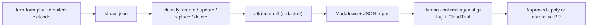

# Drift detection

## 1. What the tool does

```bash
python scripts/drift_report.py --environment dev --markdown reports/drift-dev.md
python scripts/drift_report.py --plan-json plan.json --format json
```

It runs `terraform init` (unless `--skip-init`), then `terraform plan
-detailed-exitcode`, converts the plan to JSON, and produces a report of creates,
in-place updates, replacements and destroys with attribute-level diffs.

Exit codes mirror Terraform: `0` no changes, `2` changes, `1` error.

## 2. What it cannot prove

A Terraform plan is a **proposal** derived from three inputs: configuration, state,
and (with refresh) live API data. The plan document does not say whether a diff came
from a provider-side change or from somebody editing the code. So the report labels:

| Label | Meaning |
|---|---|
| `new-resource` | Not in prior state: initial provisioning |
| `drift-candidate` | Exists in state and would change: real drift **or** an intentional edit |
| `intentional-change-unverified` | Would change, but no prior state to compare against |

Calling a candidate "verified drift" would be a lie. Confirmation requires the diff
plus `git log` plus CloudTrail.

## 3. Workflow



## 4. Reviewing a candidate

```bash
git log -p -- modules/networking | head -80
aws cloudtrail lookup-events   --lookup-attributes AttributeKey=EventName,AttributeValue=AuthorizeSecurityGroupIngress   --max-results 20
```

* Change matches a merged PR → expected, not drift.
* Change has no matching commit → unmanaged change. If it touches IAM, security
  groups or bucket policy, treat it as a security incident first, cleanup second.

## 5. Automation

`terraform-plan.yml` publishes the plan as an artefact on every PR touching
Terraform. A scheduled drift job is deliberately **not** enabled here: it would need
standing credentials and would produce noise without a human to triage it. The
report is designed to be run on demand and attached to a change record.

## 6. Report contents

| Section | Purpose |
|---|---|
| Summary | action counts by type |
| Classification | new vs drift-candidate vs unverified |
| Attribute differences | before/after per changed attribute, secrets redacted |
| Assessment sentence | states whether prior state existed |
| How to act | the three-step triage above |

Sensitive attribute names (password, secret, token, private_key, access_key,
credential) are redacted in both text and JSON output so reports are safe to commit.
