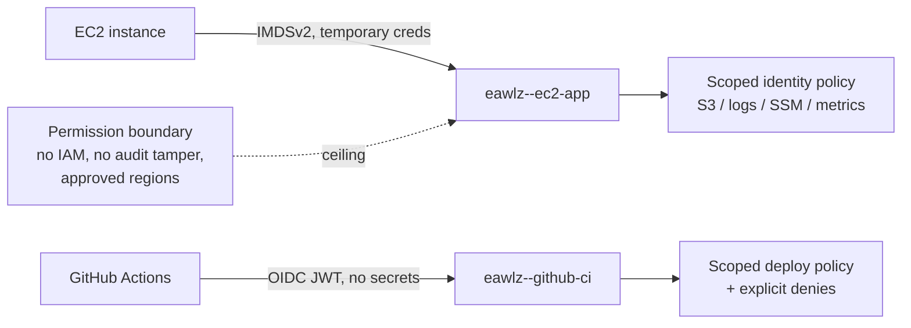

# IAM security

## 1. Model



## 2. Workload role

| Element | Decision |
|---|---|
| Trust | `ec2.amazonaws.com`, `sts:AssumeRole` only |
| Session | 1 hour max |
| S3 access | Named bucket + `config/*`, `releases/*`, `app-logs/*` prefixes only |
| S3 listing | `s3:ListBucket` with `s3:prefix` condition — cannot enumerate the bucket |
| CloudWatch Logs | `${log_group_arn}:*` — own group only |
| Metrics | `PutMetricData` restricted to one `cloudwatch:namespace` |
| SSM | Session Manager messaging + own parameter prefix |
| Credentials | Instance profile; no access keys exist anywhere |

`AmazonSSMManagedInstanceCore` is attached deliberately. It grants SSM messaging
and instance metadata only — no infrastructure read/write — and it is what makes
SSH and a bastion unnecessary.

## 3. Deny guardrails (inside the identity policy)

Explicit `Deny` beats any future `Allow`, including one added by mistake:

| Denied | Why |
|---|---|
| `iam:*`, `organizations:*`, `account:*`, `sso*` | A workload must never change identity or account structure |
| `cloudtrail:StopLogging/DeleteTrail`, `guardduty:Delete*`, `config:Stop*` | Anti-forensics |
| `kms:ScheduleKeyDeletion`, `kms:DisableKey` | Ransomware resilience |
| `s3:PutBucketPolicy/Acl/PublicAccessBlock`, `s3:DeleteBucket` | Prevent accidental public exposure |

## 4. Permission boundary

A second, independent ceiling attached to the role. Even if someone attaches
`AdministratorAccess`, the boundary blocks IAM, audit tampering, public bucket
exposure and non-approved regions.

Boundary ≠ identity policy: the boundary is intentionally narrower and never
grants anything on its own.

## 5. GitHub OIDC (keyless CI)

```text
GitHub job --> OIDC JWT --> sts:AssumeRoleWithWebIdentity --> eawlz-<env>-github-ci
```

Trust policy conditions:

1. `aud == sts.amazonaws.com`
2. `sub` ∈ {`repo:Divakar-v-cse/enterprise-aws-landing-zone:ref:refs/heads/main`,
   `...:environment:staging`, `...:environment:production`}

`repo:*` is rejected by variable validation — a wildcard subject would let any
repository in any organisation assume the role. No AWS secret is stored in
GitHub; the token is minted per run and expires in an hour.

### Hardening still to do on the CI policy

The CI deploy policy is service-scoped and deny-hardened, but not yet
tag-conditioned. Before real production use:

* add `aws:ResourceTag/Environment` conditions,
* generate a least-privilege policy from CloudTrail with IAM Access Analyzer,
* consider a separate role per environment with distinct trust subjects.

This is stated rather than implied, because a scoped-but-broad CI role is the
most common real-world weakness in landing-zone projects.

## 6. Human access

| Path | Control |
|---|---|
| Console | SSO with MFA; no IAM users created by this project |
| CLI | `aws sso login` short-lived credentials |
| Instances | `aws ssm start-session` — IAM-audited, no SSH key, no inbound port |
| Break-glass | Not automated: documented manual role assumption with MFA and CloudTrail review |

## 7. Validation

* `scripts/policy_lint.py`: no `Allow * on *`, no service-wide IAM grants,
  `Principal: "*"` only in Deny, guardrail documents must contain a Deny.
* `tests/test_policy_sync.py`-equivalent check in `tests/test_repository.py`
  asserts the reviewable copies in `policies/iam/` match the module templates.
* Checkov IAM checks run in CI.
