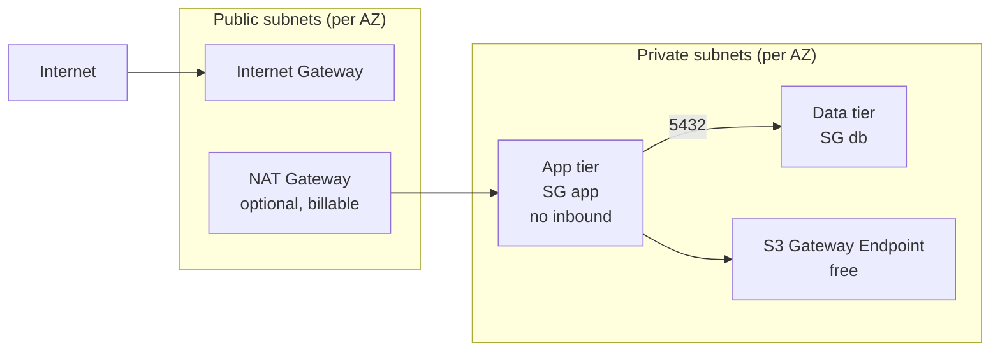

# Networking

## 1. Topology

## 2. IP plan (per environment)

| Environment | VPC | Public (3 AZs) | Private (3 AZs) | Reserved for growth |
|---|---|---|---|---|
| dev | `10.10.0.0/16` | `10.10.0.0/20`, `.16.0/20`, `.32.0/20` | `10.10.128.0/20`, `.144.0/20`, `.160.0/20` | `10.10.48–112.0/20` |
| staging | `10.20.0.0/16` | `10.20.0.0/20`, `.16.0/20`, `.32.0/20` | `10.20.128.0/20`, `.144.0/20`, `.160.0/20` | same pattern |
| production | `10.30.0.0/16` | `10.30.0.0/20`, `.16.0/20`, `.32.0/20` | `10.30.128.0/20`, `.144.0/20`, `.160.0/20` | same pattern |

`/20` subnets give 4,091 usable addresses each (AWS reserves five per subnet).
That headroom matters for EKS/ECS IP-per-task models; resizing later means
re-IP, which means redeployment.

The three VPCs are routable and non-overlapping, so a future transit gateway or
VPC peering does not require readdressing.

## 3. Segmentation rules

| Tier | Inbound | Outbound |
|---|---|---|
| Public subnets | 80, 443, ephemeral (via NACL only) | all |
| Private subnets | VPC CIDR only (NACL) | VPC CIDR + TCP 443 |
| SG `app` | **nothing by default** (opt-in CIDRs on `app_port`) | VPC CIDR (all) + TCP 443 |
| SG `db` | `db_port` from SG `app` only | VPC CIDR |
| Default SG | **all rules removed** | — |

No security group allows 22 or 3389 from anywhere. Administrative access is SSM
Session Manager, which needs no inbound port at all.

## 4. NAT Gateway: the cost decision

| Mode | Hourly | Availability | Used by |
|---|---|---|---|
| Disabled | \$0 | private subnets have no internet egress | dev (zero-cost) |
| 1 shared | ~\$0.045 | single AZ failure breaks egress | staging |
| 1 per AZ | ~\$0.135 (3 AZs) | AZ-independent egress | production |

Plus \$0.045/GB processed. The S3 gateway endpoint is free and removes S3 traffic
from the NAT path entirely, which is usually the largest data charge.

## 5. NACLs vs security groups

NACLs are stateless and subnet-level; security groups are stateful and
resource-level. This project uses **security groups as the primary control** and
keeps NACLs deliberately simple:

* Public NACL: 443, 80, ephemeral (1024–65535) in; all out.
* Private NACL: VPC CIDR in/out; 443 out; everything else denied by default.

There is no explicit `deny all` rule appended: AWS NACLs deny by default, and an
explicit deny rule adds only confusion (and scanner noise).

## 6. Tightening egress (next step for production)

The app SG allows TCP/443 to `0.0.0.0/0` because instances need OS package
repositories. To restrict it in a regulated environment:

1. Add interface endpoints for `ssm`, `ssmmessages`, `ec2messages`, `logs`,
   `monitoring` (~\$7.20/month per endpoint per AZ).
2. Replace the 443 rule with the AWS-managed prefix list for S3 plus the endpoint
   security groups.
3. Move to an egress-only inspection VPC.

Documented as an accepted risk in
[.trivyignore.yaml](../.trivyignore.yaml) until that work is scheduled.

## 7. DNS

`enable_dns_support` and `enable_dns_hostnames` are both on. Hostnames are
required for VPC endpoints, SSM registration and any future private hosted zone.
No public hosted zone is created: nothing in this platform is internet-facing.
